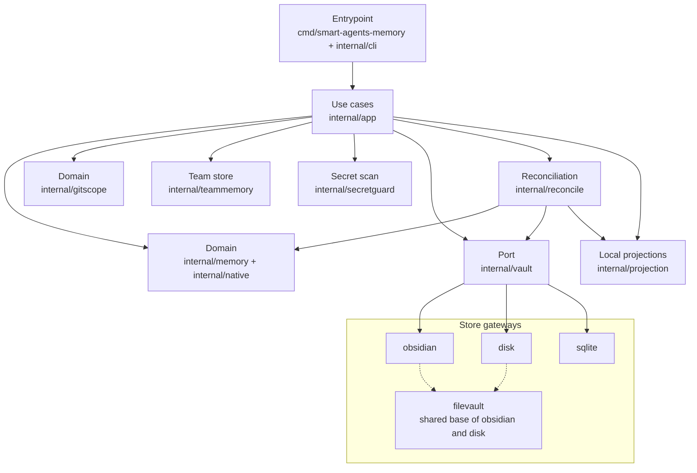

# Architecture

## The tool and the store

Smart Agents Memory is two things that must not be confused:

- **The tool** — this repository: a Go CLI, an agent skill embedded in the
  binary, and the wiring that connects the tools to the memory.
- **The store** — the user's memory: a folder of Markdown notes, or a SQLite
  database. It is private and it is not part of this repository.

The architecture follows from one rule: **one corpus, many harnesses**. The
corpus is the single source of truth; the native stores of the tools are
projections, in the format each tool already expects.

## The layers



The dependency rule is strict:

- `internal/memory`, `internal/native` and `internal/gitscope` never import
  `internal/vault`: the domain knows nothing about where the memory lives.
- `internal/vault` never imports an adapter. A gateway registers itself from
  its `init`, and `cmd/smart-agents-memory` imports it for the side effect.
- `internal/app` knows the domain and the ports. It is the layer the
  entrypoints call for behavior.
- `internal/cli` parses arguments and prints results; it contains no
  behavior that belongs to a use case.

A new gateway is one package, one `Register` call and one import line. A new
entrypoint is one package over `internal/app`; the use cases are shaped so
that an MCP server, for instance, can serve the same functions as the CLI
without touching the domain.

Supporting packages:

| Package | Responsibility |
|---|---|
| `internal/config` | Resolve the store: flag, environment, configuration file, discovery |
| `internal/gitscope` | Resolve the active Git repository and linked worktree from a directory |
| `internal/secretguard` | The high-confidence credential scan used by every memory write |
| `internal/teammemory` | The Git-backed `.agents/memory/` store and its Qwen projection |
| `internal/reconcile` | Import from the native stores, reconcile the hot tier and export the projections |
| `internal/projection` | The local directory that holds the native stores, and the watermark of the last projection |
| `internal/link` | The symlinks of the installation, with the backup of an overwritten file |
| `internal/skill` | Materialize the skill embedded in the binary |
| `internal/version` | The single source of the version |

## The port

`internal/vault.Vault` is the storage port:

```go
type Vault interface {
    Kind() string
    Root() string
    Entries(ctx context.Context) ([]memory.Entry, error)
    Create(ctx context.Context, e memory.Entry) (memory.Entry, error)
    Update(ctx context.Context, e memory.Entry) error
    Search(ctx context.Context, query string, limit int) ([]Hit, error)
    AppendLog(ctx context.Context, line string) error
    LogLines(ctx context.Context, limit int) ([]string, error)
    Ready(ctx context.Context) error
}
```

`Ready` is how a use case asks whether the store exists. It does not look
for a `corpus/` directory, and it does not branch on the gateway name: a
file store is a directory, and a SQLite store is a database file.

The methods are the minimum the use cases need. A capability that only some
gateways have is a separate optional interface:

| Interface | For | Implemented by |
|---|---|---|
| `Layout` | Creating the store | `obsidian`, `disk`, `sqlite` |
| `ProjectNotes` | The notes of a project | `obsidian`, `disk`, `sqlite` |
| `WorktreeNotes` | The notes of a project worktree | `obsidian`, `disk`, `sqlite` |
| `ProjectNoteLister` / `ProjectNoteRemover` | Listing and deleting project notes | `obsidian`, `disk`, `sqlite` |
| `Renamer` / `Remover` | Moving and deleting an entry | `obsidian`, `disk`, `sqlite` |
| `IndexLocator` / `IndexWriter` | Publishing the index | `obsidian`, `disk`, `sqlite` |
| `Diagnostics` | Notes that could not be read | `obsidian`, `disk` |

The use case checks for the interface with a type assertion. A gateway that
does not implement one simply does not have the feature, and the use case
says so when the feature was requested.

## The corpus

The corpus is a set of entries. In the file gateways, one entry is one
Markdown note: YAML frontmatter, the title as a heading, the body. In SQLite
the same entry is a row, and the frontmatter fields become columns. The
format is a contract with the tools and with the people who edit the notes
by hand; the full field table lives in
[corpus-format.md](skills/smart-agents-memory/references/corpus-format.md).

```
<store>/
  corpus/
    user/
    lesson/
    project/
    reference/
    INDEX.md                  the plain index (disk gateway)
  projects/<project>.md
  projects/<project>@<worktree>.md
  log/YYYY-MM-DD.md
  MEMORY.md                   the hot tier
  native/                     the projections (file gateways)
  Smart Agents Memory.md      the Obsidian index
```

The file gateways keep the corpus, the hot tier and the projections inside
the store. The SQLite gateway keeps the corpus in the database and
materializes `MEMORY.md` and `native/` in the projection root, which is
`~/.local/share/smart-agents-memory/` by default.

## Project and worktree scope

`internal/gitscope` resolves the repository and the linked worktree from the
working directory. It reads `.git` and `commondir`; it does not run `git`.

- The **project** is the repository root: a decision is repository-wide.
- The **worktree** is a linked checkout: a branch-local note is opt-in.

`add --scope project` resolves the project from the current directory.
`--worktree auto` adds the worktree. `brief` resolves both automatically,
unless `--global` is passed. The output is the hot tier, the global index,
`## Project: <slug>` and, when there is one, `## Worktree: <slug>@<id>`.

A worktree that no longer exists leaves entries and notes behind. `doctor`
reports them; `prune-worktrees --apply` removes the unpinned, cold ones and
reexports the projections. A pinned or hot entry, and the note of its
worktree, are kept.

## Team memory

`internal/teammemory` is a second corpus, inside the repository and shared
through Git. The primary layout is `.agents/memory/`; `.qwen/team-memory/`
is an optional projection in the Qwen topic format. It is not behind the
vault port: a team entry belongs to the repository, not to the private
store, and `add --team` writes only there.

The store refuses a symlink at `.agents`, `.agents/memory`, `.qwen` or
`.qwen/team-memory`, and skips a symlinked file while reading. Every write
passes through `internal/secretguard`; the native import does too, so a
credential in a projection is skipped instead of entering the corpus.

## Reconciliation

`smart-agents-memory index` keeps the corpus and the native stores in step.
It runs in this order:

1. **Import.** The native stores are read. An entry the corpus does not know
   is added. An entry both sides have is resolved by modification time: a
   projection has to be strictly newer than the corpus to replace it, so a
   manual edit is not reverted by an older projection. A pinned entry is
   never replaced: it is user-curated, and export restores the projection. A
   projection this tool wrote is not news: `internal/projection` records the
   watermark of the last projection in `.smart-agents-memory-state.json`.
2. **The hot tier.** `MEMORY.md` is read before the export. A block edited
   after the last projection is imported when it is newer than the corpus.
   A pinned hot entry is never replaced, like any other pinned entry. A
   freeform block, with no `###` headings, is imported once as a `user`
   entry titled `Profile`. The frontmatter of `MEMORY.md` is kept, because
   Cursor requires `alwaysApply: true`.
3. **Export.** The corpus is materialized into the native stores: the hot
   entries go into the injected stores and `MEMORY.md`, the cold entries of
   the MiniMax stores become topic files, and the Qwen files and index are
   written. A pinned Qwen entry goes under `pinned/<file>.md`. A projection
   is regenerated, never merged. A file whose bytes already match is left
   alone, so its modification time does not look like a newer edit. A
   projection that no entry backs is removed.
4. **Index.** A gateway that publishes an index does it here: the Obsidian
   gateway writes an Obsidian-native note with wikilinks, and the disk
   gateway writes a plain Markdown index.

Every gateway supplies `Entry.ModTime`: the file modification time, or the
`updated_at` column of SQLite. Without it, the tie could not be resolved.
The native formats do not carry the project or worktree, so an import keeps
the scope already stored in the corpus.

A projection that no corpus entry backs is an orphan. Export removes it and
`doctor` reports it, because the runtime would inject it without a
counterpart. `migrate` still removes the orphans of a legacy store.

## Tiers and the context budget

| Tier | Where it goes | What it costs |
|---|---|---|
| `hot` | `MEMORY.md`, the injected MiniMax store and the global instruction slot | Always in the context |
| `cold` | A topic file in MiniMax Code; fetched on demand elsewhere | A line of metadata, or a read |

The memory is not dumped into the context. The MiniMax runtime injects the
profile and only the name and the description of each topic; the body is
read on demand. The same idea holds for Qwen Code: its topics carry the
metadata, and the body is fetched when the tool needs it.

## The installation

`smart-agents-memory install` wires the tools to the store with symlinks:

| Kind | Count | Targets | Why |
|---|---|---|---|
| Directory | 3 | The native stores | The MiniMax runtime writes with a temporary file plus a rename; a rename over a symlink of a file would replace the link |
| File | 6 | The global instruction slots | Those tools only read |
| Directory | 8 | The skill directories | The skill is materialized once and linked everywhere |

The install is idempotent, and it creates the store when there is none.
When a target exists and is not a symlink, a tool rewrote it: the previous
content is preserved next to it with the `.bak-smart-agents-memory` suffix,
and the link is recreated. An earlier backup is kept, and the new one gets
a numeric suffix. The details are in [SECURITY.md](SECURITY.md).

## Configuration

The store is resolved in this order: the flag, the environment variable, the
configuration file, and discovery. The file gateways default to
`~/Smart Agents Memory`; the configuration file is
`~/.config/smart-agents-memory/config.json`. The backend defaults to
`obsidian`.

```json
{
  "vault": "sqlite",
  "sqlite_path": "~/memory.db",
  "projection_root": "~/.local/share/smart-agents-memory"
}
```

The keys are `vault`, `memory_home`, `sqlite_path` and `projection_root`.
The environment variables are `SMART_AGENTS_MEMORY_HOME`,
`SMART_AGENTS_MEMORY_VAULT`, `SMART_AGENTS_MEMORY_DATABASE` and
`SMART_AGENTS_MEMORY_SOURCE`.

The choice of backend is configuration, not a fork: the same use cases run
over any gateway behind the port. The gateway is named explicitly by
`--vault`, and a name that is not registered is an error that lists the
registered ones.

## Contracts

The contracts that must not break are listed in [AGENTS.md](AGENTS.md). The
tests that hold them are in [TESTING.md](TESTING.md). The two that shape this
document:

- The format of an entry is shared by `internal/memory/frontmatter.go` and
  the corpus format reference.
- The projection formats in `internal/native` are read by the tools, so a
  change there changes what every tool sees.
