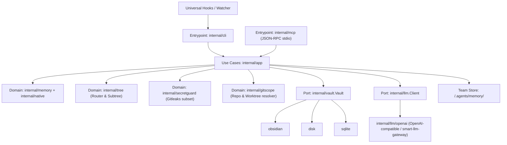

# Smart Agents Memory — Technical Specification (`SPEC.md`)

This specification defines six capabilities inspired by Qwen Code's memory subsystem, adapted to the **Ports and Adapters** architecture of **Smart Agents Memory** without harness lock-in:

1. **Phase 1 — Immutable Pinned Protection (`Pinned` & `pinned/`)**
2. **Phase 2 — Repository & Git Worktree Scope (`internal/gitscope`)**
3. **Phase 3 — Git-Backed Team Memory (`.agents/memory/`) & `SecretGuard` (`internal/secretguard`)**
4. **Phase 4 — Taxonomy Categories, Tree Snapshot & `Structured Recall` (`internal/tree`, `recall`, `mcp`)**
5. **Phase 5 — Pluggable `internal/llm` Port & Background Consolidation (`Dream`)**
6. **Phase 6 — Post-Turn Automatic Extraction (`Extract`) & Universal Hooks / Transcript Watcher**

---

## 1. Architectural Invariants & Contracts

Every phase must preserve the existing contracts defined in `AGENTS.md`, `ARCHITECTURE.md`, `CONVENTIONS.md`, `TESTING.md`, `SECURITY.md`, and `docs/MEMORY_FORMAT.md`:

1. **The corpus is the single source of truth.** Native tool stores (`minimax-user`, `minimax-agent`, `minimax-store`, `qwen`) are projections. Projections are regenerated, never merged. On conflict during `index`, the most recent modification time (`ModTime`) wins — except for `Pinned` entries, which automated imports and background jobs may never overwrite or delete.
2. **Ports and adapters on both sides.**
   - **Entrypoints** (`cmd/smart-agents-memory`, `internal/cli`, `internal/mcp`) parse inputs and format outputs; all behavior lives in `internal/app`.
   - **Use cases** (`internal/app`) depend only on the domain (`internal/memory`, `internal/native`, `internal/tree`, `internal/secretguard`, `internal/gitscope`) and abstract ports (`internal/vault`, `internal/llm`).
   - **Gateways** (`internal/vault/obsidian`, `internal/vault/disk`, `internal/vault/sqlite`, `internal/llm/openai`) register or wire behind their ports.
   - **Domain purity:** `internal/memory` and `internal/native` must never import `internal/vault` or `internal/llm`.
3. **Gateway round-trip invariance.** `TestBackendsCarryTheSameCorpus` and `TestTheCorpusTravelsBetweenBackends` in `internal/vault/vault_test.go` must pass with all new `memory.Entry` fields (`Pinned`, `Project`, `Worktree`, `Category`, `UsageScenarios`). Unknown YAML frontmatter keys must continue round-tripping through `Entry.Extra`.
4. **Zero-network test suite.** `gofmt -l .`, `go vet ./...`, and `go test ./...` must run offline with no external API tokens, using deterministic fakes for the LLM port.
5. **Vocabulary & language.** All code, identifiers, flags, comments, docs, and stored memory entries use English (`en-US`). Never use project-phase words (`mvp`, `pilot`, `beta`) in any identifier, path, flag, or comment.

**Out of scope — Notion.** The `notion` gateway was removed in `0.2.0` because it was never verified against the real Notion API. This specification does not reintroduce it: every phase applies to `obsidian`, `disk`, and `sqlite` only.

---

## 2. Target Architecture Overview



---

## 3. Phase-by-Phase Specification

---

### Phase 1: Immutable Pinned Protection (`Pinned` & `pinned/`)

#### 1.1 Goal
Protect curated entries and permanent rules from being overwritten, modified, or deleted by automated imports (`index`), background consolidation (`dream`), or post-turn extraction (`extract`), while projecting pinned entries into Qwen Code's protected `pinned/` subdirectory so Qwen Code's own background agents cannot mutate them either.

#### 1.2 Domain & Frontmatter Changes (`internal/memory`)
- In `internal/memory/entry.go`, add to `type Entry struct`:
  ```go
  // Pinned protects the entry from automated edits, imports, and consolidation.
  Pinned bool
  ```
- In `internal/memory/frontmatter.go`:
  - Add `"pinned"` to `knownKeys`.
  - In `Parse(text string)`: set `entry.Pinned = flat["pinned"] == "true"`.
  - In `Format(e Entry)`: when `e.Pinned` is `true`, emit `pinned: true\n` after `tier`. Omit the key when `false` so unpinned notes keep their exact current format.

#### 1.3 Gateway Updates (`internal/vault/*`)
- **`filevault` (`internal/vault/filevault/filevault.go`):**
  - When reading an entry (`readEntry`), if its relative path contains a `/pinned/` segment (or starts with `pinned/` or `corpus/pinned/`), set `entry.Pinned = true` even if the YAML property was omitted by hand in Obsidian.
- **`sqlite` (`internal/vault/sqlite/sqlite.go`):**
  - Add `pinned INTEGER NOT NULL DEFAULT 0` to the `entries` table definition.
  - Add an idempotent schema migration helper on `sql.Open` that checks `PRAGMA table_info(entries)` and runs `ALTER TABLE entries ADD COLUMN pinned INTEGER NOT NULL DEFAULT 0` if missing.
  - Read and write `e.Pinned` (`0` or `1`) in `Entries`, `Create`, and `Update`.
- Update `internal/vault/vault_test.go` fixtures to assert `Pinned` round-trips across `obsidian`, `disk`, and `sqlite`.

#### 1.4 Native Projections & Reconciliation (`internal/native`, `internal/reconcile`)
- **`TargetQwen` projection (`internal/reconcile/reconcile.go` & `internal/projection/projection.go`):**
  - In `projection.Store.List(target, sub)`: support listing both top-level `.md` files and `pinned/*.md` for `native.TargetQwen`.
  - In `Reconciler.Export`: for `e.Native == "qwen"`, if `e.Pinned` is `true`, write the topic file under `pinned/<filename>.md` (unless `e.NativeFile` already has `pinned/` prefixed) and link it in `native/qwen/MEMORY.md` as `- [Title](pinned/<filename>.md) — <description>`. If an entry transitions from unpinned to pinned (or vice versa), remove the stale file at the old relative path.
  - In `Reconciler.candidates()`: when reading `native/qwen/pinned/*.md`, set `candidate.Pinned = true`.
- **Immutability guard in `Reconciler.Import`:**
  - When `current, ok := byTitle[key]` exists and `current.Pinned` is `true`, **never** overwrite `current` from a native projection candidate, even if `candidate.ModTime.After(current.ModTime)`.
- **Immutability guard in `App.Add` (`internal/app/app.go`):**
  - Add `Pinned bool` to `AddOptions`.
  - When `Add` finds an existing entry with the same normalized title and `e.Pinned` is `true`:
    - If `!opts.Force`, return an error: `fmt.Errorf("entry %q is pinned; pass --force to modify it", e.Title)`.
    - If `opts.Force`, preserve `e.Pinned = true` (or set `e.Pinned = opts.Pinned` when explicitly passed) and record `(forced on pinned)` in the write log.
- **Pin / Unpin Use Cases & CLI (`internal/app`, `internal/cli`):**
  - Add `--pinned` boolean flag to `smart-agents-memory add`.
  - Add `App.SetPinned(ctx context.Context, title string, pinned bool) (string, error)` and CLI commands:
    - `smart-agents-memory pin <title>`
    - `smart-agents-memory unpin <title>`
  - Both update the entry in `Vault`, re-export projections, and append `pin | <scope> | <title>` or `unpin | <scope> | <title>` to the write log.

#### 1.5 Phase 1 Verification Gate
- Unit tests in `internal/memory/memory_test.go` for `pinned: true` YAML parse/format round-trip.
- Round-trip tests in `internal/vault/vault_test.go`.
- Reconciliation test in `internal/app/app_test.go` proving a newer native edit cannot overwrite a pinned corpus entry, and Qwen pinned entries land in `native/qwen/pinned/<slug>.md`.
- CLI tests in `internal/cli/cli_test.go` for `add --pinned`, refusal without `--force`, `pin`, and `unpin`.

---

### Phase 2: Repository & Git Worktree Scope (`internal/gitscope`)

#### 2.1 Goal
Automatically resolve the active Git repository and linked `git worktree` from the current working directory (`CWD`), allowing `brief`, `add`, and `search` to scope project decisions to the repository while isolating branch/worktree-specific state to the active worktree.

#### 2.2 Git Scope Resolver (`internal/gitscope`)
Create package `internal/gitscope` using pure Go filesystem inspection (no `git` subprocess required, so it is fast and deterministic in sandboxed tests):
- Walk upwards from `startDir` looking for `.git`:
  - **Standard checkout:** `.git` is a directory.
    - `WorktreeRoot` = directory containing `.git`
    - `RepoRoot` = `WorktreeRoot`
    - `RepoSlug` = `memory.Slugify(filepath.Base(RepoRoot))`
    - `WorktreeID` = `""` (main worktree)
  - **Linked worktree:** `.git` is a regular file containing `gitdir: <path>` pointing to `<common-git-dir>/worktrees/<worktree-name>`.
    - `WorktreeRoot` = directory containing the `.git` file
    - `WorktreeID` = `memory.Slugify(<worktree-name>)`
    - Read `<gitdir>/commondir` (or parent `../..` of `worktrees/<name>`) to resolve the canonical `<common-git-dir>`, whose parent directory is `RepoRoot`.
    - `RepoSlug` = `memory.Slugify(filepath.Base(RepoRoot))`
- Expose:
  ```go
  type Info struct {
      RepoRoot     string
      RepoSlug     string
      WorktreeRoot string
      WorktreeID   string
  }

  func Resolve(startDir string) (Info, bool)
  func ActiveWorktrees(repoRoot string) (map[string]bool, error)
  ```

#### 2.3 Domain, Frontmatter & Gateway Changes
- In `internal/memory/entry.go`, add to `Entry`:
  ```go
  // Project is the repository or project slug an entry belongs to, when scoped.
  Project string
  // Worktree is the linked git worktree identifier, when scoped to one worktree.
  Worktree string
  ```
- In `internal/memory/frontmatter.go`:
  - Add `"project"` and `"worktree"` to `knownKeys`.
  - Parse and format `project` and `worktree` when non-empty.
- In `internal/vault/sqlite/sqlite.go`:
  - Add `project TEXT NOT NULL DEFAULT ''` and `worktree TEXT NOT NULL DEFAULT ''` columns (with idempotent `ALTER TABLE` migration for existing databases) and index `CREATE INDEX IF NOT EXISTS entries_project ON entries(project)`.
- In `internal/vault/filevault/filevault.go`:
  - Extend `ProjectNote(ctx context.Context, name string)` or add `WorktreeNote(ctx context.Context, project, worktree string) (string, bool, error)` reading `projects/<project>@<worktree>.md` when a worktree note exists alongside `projects/<project>.md`.

#### 2.4 Application & CLI Behavior (`internal/app`, `internal/cli`)
- **`smart-agents-memory add`:**
  - Add flags `--project <slug>` and `--worktree <id>`.
  - When `--scope project` is used and `--project` is not explicitly passed, auto-resolve `gitscope.Resolve(cwd)` and set `opts.Project = info.RepoSlug` (and `opts.Worktree = info.WorktreeID` only when `--worktree auto` is passed, so durable project decisions default to repo-wide while worktree-local notes are opt-in).
- **`smart-agents-memory brief`:**
  - Add flags `--worktree <id>` and `--global` (disables CWD auto-detection).
  - If `--project` is empty and `--global` is false, call `gitscope.Resolve(cwd)` to fill `project = info.RepoSlug` and `worktree = info.WorktreeID` (do not emit `"project not found"` warning when auto-detected and no project note exists yet; only warn when `--project` was explicitly passed).
  - Output order in `Brief`:
    1. Hot tier (`MEMORY.md`)
    2. `## Project: <project>` (content of `projects/<project>.md` + summary/bodies of corpus entries where `e.Project == project && e.Worktree == ""`)
    3. If `worktree != ""`: `## Worktree: <project>@<worktree>` (content of `projects/<project>@<worktree>.md` + corpus entries where `e.Project == project && e.Worktree == worktree`).
- **Stale worktree cleanup (`doctor` and `prune-worktrees`):**
  - `smart-agents-memory doctor`: when run inside a Git repository, reports any corpus entries or project notes scoped to a `Worktree` that is no longer present in `gitscope.ActiveWorktrees(info.RepoRoot)`.

#### 2.5 Phase 2 Verification Gate
- Unit tests in `internal/gitscope/gitscope_test.go` covering: non-git directory, standard `.git/` directory, linked `.git` file with `gitdir:` and `commondir`, and `ActiveWorktrees`.
- Round-trip tests in `vault_test.go` with `Project` and `Worktree` populated.
- `app_test.go` and `cli_test.go` tests verifying auto-detected `brief` and `add --scope project` from both a main repo checkout and a linked worktree.

---

### Phase 3: Git-Backed Team Memory (`.agents/memory/`) & High-Confidence `SecretGuard`

#### 3.1 Goal
Allow project memories to be shared across a team via Git in a vendor-neutral `<repo-root>/.agents/memory/` directory (with seamless import/export interoperability for `<repo-root>/.qwen/team-memory/`), guarded by a zero-leak credential scanner (`internal/secretguard`) that runs on **all** memory writes (team and private vault alike).

#### 3.2 Secret Scanner (`internal/secretguard`)
Create `internal/secretguard` porting the 18 high-confidence `gitleaks` rules from Qwen Code's `secret-scanner.ts`:
- Rules to include (compiled once via `sync.Once`):
  1. `aws-access-token`: `\b((?:A3T[A-Z0-9]|AKIA|ASIA|ABIA|ACCA)[A-Z0-9]{16})\b`
  2. `alibaba-cloud-access-key`: `\b(LTAI[a-zA-Z0-9]{12,20})\b`
  3. `gcp-api-key`: `AIza[\w-]{35}`
  4. `gcp-oauth-client-secret`: `GOCSPX-[\w-]{24}`
  5. `digitalocean-pat`: `dop_v1_[a-f0-9]{64}`
  6. `anthropic-api-key`: `sk-ant-[a-zA-Z0-9_-]{20,}`
  7. `openai-api-key`: `sk-(?:proj|svcacct|admin)-[a-zA-Z0-9_-]{20,}|sk-[a-zA-Z0-9_-]{20,512}T3BlbkFJ[a-zA-Z0-9_-]{20,512}|sk-[a-zA-Z0-9]{48}`
  8. `huggingface-access-token`: `hf_[a-zA-Z0-9]{34,}`
  9. `github-pat`: `ghp_[0-9a-zA-Z]{36}`
  10. `github-fine-grained-pat`: `github_pat_\w{82}`
  11. `github-app-token`: `(?:ghu|ghs)_[0-9a-zA-Z]{36}`
  12. `github-oauth`: `gho_[0-9a-zA-Z]{36}`
  13. `gitlab-pat`: `glpat-[\w-]{20}`
  14. `slack-bot-token`: `xox[b]-[0-9]{10,13}-[0-9]{10,13}[a-zA-Z0-9-]*`
  15. `slack-app-token`: `(?i)xapp-\d-[A-Z0-9]+-\d+-[a-z0-9]+`
  16. `sendgrid-api-token`: `SG\.[\w-]{22}\.[\w-]{43}`
  17. `npm-access-token`: `npm_[a-zA-Z0-9]{36}`
  18. `stripe-access-token`: `(?:sk|rk)_(?:test|live|prod)_[a-zA-Z0-9]{10,99}`
  19. `private-key`: `(?is)-----BEGIN[ A-Z0-9_-]{0,100}PRIVATE KEY(?: BLOCK)?-----.{64,16384}?-----END[ A-Z0-9_-]{0,100}PRIVATE KEY(?: BLOCK)?-----`
- API:
  ```go
  type Match struct {
      RuleID string
      Label  string
  }

  // Scan inspects text and returns one Match per triggered rule.
  // It never returns or logs the matched secret substring.
  func Scan(text string) []Match

  // Check returns an error listing the matched rule labels if any secret is found.
  func Check(title, body string) error
  ```
- **Enforcement:** Call `secretguard.Check(entry.Title, entry.Body)` in:
  - `App.Add`
  - `Reconciler.Import` (skip and log a warning when a native store file contains a secret, rather than importing the secret into the vault)
  - Team memory writes and imports
  - `App.Dream` and `App.Extract` (Phases 5 and 6)

#### 3.3 Git-Backed Team Memory (`internal/teammemory`)
- **Storage layout inside a Git repository (`<WorktreeRoot>`):**
  - Primary vendor-neutral directory: `<WorktreeRoot>/.agents/memory/`
  - Optional Qwen Code projection directory: `<WorktreeRoot>/.qwen/team-memory/`
  - Inside `.agents/memory/`:
    - `MEMORY.md` (auto-generated Markdown index of team entries)
    - `corpus/<type>/<slug>.md` (or `<type>/<slug>.md`, using standard `memory.Format(e)`)
- **Security boundary (symlink & traversal defense):**
  - Port Qwen Code's `trusted-memory-filesystem.ts` rule: resolve `<WorktreeRoot>` as the trusted anchor, and verify via `os.Lstat` that `.agents`, `.agents/memory`, and every subdirectory/file inside it are real directories/regular files (refuse symlinks pointing outside `<WorktreeRoot>`).
- **CLI & Use Cases:**
  - `smart-agents-memory add --team`:
    - Requires running inside a Git repository (`gitscope.Resolve(cwd)`).
    - Rejects `--scope user` (`team memory cannot store personal user profile entries; use lesson, project, or reference`).
    - Runs `secretguard.Check`.
    - Writes the entry to `<WorktreeRoot>/.agents/memory/<type>/<slug>.md` and refreshes `<WorktreeRoot>/.agents/memory/MEMORY.md`.
    - If `<WorktreeRoot>/.qwen/team-memory/` exists (or `--native qwen` is requested), also projects the entry in Qwen format into `.qwen/team-memory/`.
  - `smart-agents-memory brief` and `smart-agents-memory search`:
    - When inside a Git repo containing `.agents/memory/` (or `.qwen/team-memory/`), read team entries and include them in `Brief` under `## Team Memory (<repo-slug>)` and in `Search` results prefixed with `[team] `.

#### 3.4 Phase 3 Verification Gate
- Table-driven unit tests in `internal/secretguard/secretguard_test.go` testing positive detection and zero-value-echo for all 19 patterns, plus negative tests on ordinary prose, UUIDs, SHA-256 hashes, and code snippets.
- Unit & integration tests for team memory creation, symlink escape rejection, `.qwen/team-memory` sync, `brief` inclusion, and refusal of `--scope user --team`.

---

### Phase 4: Taxonomy Categories, Tree Snapshot & `Structured Recall` (`internal/tree`, `recall`, `mcp`)

#### 4.1 Goal
Organize the corpus into Qwen Code's 20 semantic categories + usage scenarios, build a deterministic token-budgeted **Memory Tree Router** (`<= 6000` chars), provide a `smart-agents-memory recall` command for selective on-demand context retrieval, and expose an **MCP Server** (`smart-agents-memory mcp`) over `stdio`.

#### 4.2 Taxonomy & Frontmatter Extensions (`internal/memory`)
- Add to `memory.Entry`:
  ```go
  Category       string
  UsageScenarios []string
  ```
- Add `"category"` and `"usage_scenarios"` to `knownKeys` in `internal/memory/frontmatter.go`.
  - Parse `usage_scenarios` as a YAML string list (same as `keywords`).
  - Format `category` (when non-empty) and `usage_scenarios` (when non-empty).
- Define standard categories in `internal/memory/category.go` (matching Qwen Code's `AUTO_MEMORY_TREE_CATEGORIES` in `types.ts`):
  - `basic_information`, `hobbies`, `communication_preference`, `behavior_habit`
  - `project_introduction`, `tech_stack`, `build_configuration`, `dependency_configuration`, `ide_configuration`, `scm_configuration`, `environment_configuration`
  - `code_standard`, `practice_standard`, `testing_standard`, `comment_standard`
  - `tool_experience`, `mcp_experience`, `common_pitfall`, `important_decision`, `task_summary`
  - Fallback: `uncategorized`
- Add deterministic helper `InferCategory(e Entry) string` that returns `e.Category` if valid, or maps `(e.Type, e.Keywords, e.Title)` to the best default category (e.g., `TypeUser` -> `communication_preference` / `behavior_habit`, `TypeProject` -> `important_decision`, `TypeLesson` -> `common_pitfall` / `practice_standard`, `TypeReference` -> `tool_experience`) before falling back to `uncategorized`.
- Update `sqlite.go` (columns `category`, `usage_scenarios` with auto-migration), plus `native.RenderQwen` and `native.ParseQwen` (using `InferCategory(e)` and `e.UsageScenarios` instead of hardcoded `shared_memory`).
- Add `--category <cat>` and `--scenario <text>` (comma-separated or repeatable) to `smart-agents-memory add`.

#### 4.3 Memory Tree Snapshot & Router (`internal/tree`)
Create package `internal/tree` porting the core model of Qwen Code's `tree.ts` (in English):
- Constants:
  - `RouterCharBudget = 6000`
  - `RouterTruncationReserve = 96`
  - `CategoryKeywordLimit = 12`
- Types:
  ```go
  type Leaf struct {
      Ref            string   `json:"ref"`             // e.g. "lesson:ci-is-not-the-test-loop" or "team:project/architecture"
      Scope          string   `json:"scope"`           // "user", "lesson", "project", "reference", "team"
      Category       string   `json:"category"`
      Title          string   `json:"title"`
      Description    string   `json:"description"`
      Keywords       []string `json:"keywords"`
      UsageScenarios []string `json:"usage_scenarios,omitempty"`
      Pinned         bool     `json:"pinned,omitempty"`
  }

  type CategoryNode struct {
      Category           string   `json:"category"`
      Total              int      `json:"total"`
      Leaves             []Leaf   `json:"leaves"`
      Keywords           []string `json:"keywords"`
      HiddenKeywordCount int      `json:"hidden_keyword_count,omitempty"`
  }

  type Snapshot struct {
      Revision     string         `json:"revision"` // SHA-256 hex of canonical leaves
      Categories   []CategoryNode `json:"categories"`
      RouterPrompt string         `json:"router_prompt"`
  }
  ```
- Functions:
  - `BuildSnapshot(entries []memory.Entry, teamEntries []memory.Entry) Snapshot`
  - `RenderRouter(categories []CategoryNode) string`: renders a compact category tree showing category name, entry count, top keywords, and leaf refs/titles within `RouterCharBudget`.
  - `RenderSubtree(snap Snapshot, categories []string, query string, maxChars int) string`: renders the focused tree with `Description` and `UsageScenarios` for matching leaves.

#### 4.4 `Structured Recall` Use Case & CLI (`internal/app/recall.go`, `internal/cli`)
- `App.Recall(ctx context.Context, opts RecallOptions) (RecallResult, error)`:
  - Builds the combined corpus + active repo/worktree + team memory entries.
  - Supports 3 modes:
    1. `--tree`: returns the compact `Snapshot.RouterPrompt` (or focused subtree if `--category` is given).
    2. `--ref <ref1,ref2>`: fetches the exact full bodies of the specified memory refs.
    3. `--query <text>`: ranks cold + project + team entries by a deterministic relevance score (matching normalized terms against `Title` [weight 5], `Keywords` [weight 4], `Category` [weight 3], `UsageScenarios` [weight 3], `Description` [weight 2], and `Body` [weight 1]; boosting active `Project`/`Worktree` matches), or uses the optional LLM selector (Phase 5) when `--llm` is passed, and returns the top `--limit` (default 5) entries within `--max-chars` (default 12000).
- CLI command:
  ```bash
  smart-agents-memory recall --tree
  smart-agents-memory recall --category common_pitfall,testing_standard
  smart-agents-memory recall --query "flaky sqlite migration" --limit 5
  smart-agents-memory recall --ref "lesson:ci-is-not-the-test-loop"
  ```

#### 4.5 MCP Server Entrypoint (`internal/mcp`, `smart-agents-memory mcp`)
Create package `internal/mcp` implementing a lightweight, dependency-free JSON-RPC 2.0 MCP server over `stdin`/`stdout` (`initialize`, `notifications/initialized`, `tools/list`, `tools/call`):
- Exposed MCP tools:
  1. `memory_tree`: returns the compact category router (`Snapshot.RouterPrompt`) and `revision`.
  2. `memory_recall`: accepts `query`, `categories`, `refs`, `limit` and returns matched entries with full bodies.
  3. `memory_search`: line-level search over the store (`App.Search`).
  4. `memory_brief`: returns the hot profile + active project/worktree/team brief (`App.Brief`).
  5. `memory_add`: records a new memory (`App.Add`, protected by `SecretGuard` and `Pinned` rules).

#### 4.6 Phase 4 Verification Gate
- Unit tests in `internal/tree/tree_test.go` verifying category grouping, keyword aggregation (`<= 12` + `HiddenKeywordCount`), deterministic SHA-256 `Revision`, and strict adherence to `RouterCharBudget = 6000`.
- Unit tests in `internal/app/app_test.go` for `Recall` (`--tree`, `--query`, `--category`, `--ref`).
- Unit tests in `internal/mcp/mcp_test.go` driving the JSON-RPC loop over `bytes.Buffer` pipes for `initialize`, `tools/list`, and all 5 `tools/call` handlers.

---

### Phase 5: Pluggable `internal/llm` Port & Background Consolidation (`Dream`)

#### 5.1 Goal
Deduplicate, merge, backfill keywords/categories/descriptions, and clean up cold memories through a two-stage `smart-agents-memory dream` command: a zero-network deterministic stage followed by an optional LLM-assisted semantic consolidation stage behind a pluggable `internal/llm.Client` port (compatible with `smart-llm-gateway` and any OpenAI-compatible endpoint).

#### 5.2 The `internal/llm` Port & OpenAI-Compatible Adapter
- Define `internal/llm/llm.go`:
  ```go
  package llm

  import "context"

  type Request struct {
      SystemPrompt string
      UserPrompt   string
      Temperature  float64
  }

  type Client interface {
      Kind() string
      CompleteJSON(ctx context.Context, req Request, out any) error
  }
  ```
- Define `internal/llm/openai/openai.go`:
  - Uses standard `net/http` against `<BaseURL>/chat/completions` (defaulting `BaseURL` to `http://127.0.0.1:8080/v1` for local `smart-llm-gateway` or `https://api.openai.com/v1` when an API key env var is set).
  - Extracts JSON from the assistant message (stripping optional markdown ```json fences) and unmarshals into `out`.
- Configuration (`internal/config/config.go` & `internal/vault/vault.go`):
  - Add to `config.File` and `vault.Config`:
    - `LLMProvider string` (`json:"llm_provider,omitempty"`, default `"openai"`)
    - `LLMBaseURL string` (`json:"llm_base_url,omitempty"`, env `SMART_AGENTS_MEMORY_LLM_URL`)
    - `LLMModel string` (`json:"llm_model,omitempty"`, env `SMART_AGENTS_MEMORY_LLM_MODEL`)
    - `LLMKeyEnv string` (`json:"llm_key_env,omitempty"`, env `SMART_AGENTS_MEMORY_LLM_KEY_ENV`, default `"SMART_AGENTS_MEMORY_LLM_API_KEY"`)
  - **Security rule:** The raw API key is never stored in `config.json`, only the environment variable name (`LLMKeyEnv`).
- Wire optional LLM selector into Phase 4's `App.Recall`: when `--llm` is requested and `llm.Client` is configured, format the compact manifest (`MAX_MODEL_MANIFEST_BYTES = 25000`, porting `relevanceSelector.ts`) and validate that every returned ref exists in the manifest.

#### 5.3 Consolidation State, Locking & Snapshot Diffing (`internal/app/dream.go`)
- State file `<LocalRoot>/.smart-agents-memory-dream.json`:
  ```go
  type DreamState struct {
      Version        int       `json:"version"`
      LastDreamAt    time.Time `json:"last_dream_at,omitempty"`
      DirtyMutations int       `json:"dirty_mutations"`
      LastStatus     string    `json:"last_status,omitempty"` // "idle", "running", "updated", "noop", "failed"
  }
  ```
  - Increment `DirtyMutations` on every `App.Add` and `Reconciler.Import` that adds or updates an entry.
- Lock file `<LocalRoot>/.consolidation.lock`:
  - Acquired with `os.O_CREATE|os.O_EXCL|os.O_WRONLY` containing `{"pid": <pid>, "started_at": "<RFC3339>"}`.
  - Automatically breaks stale locks older than 15 minutes.
- **Two-Stage `App.Dream(ctx context.Context, opts DreamOptions) (DreamReport, error)`:**
  - **Protection boundary:** Entries with `e.Pinned == true` or `e.EffectiveTier() == memory.TierHot` are **read-only context** during Dream — they can never be merged away, deleted, or modified by Dream.
  - **Stage 1 — Deterministic Pass (always runs, offline):**
    1. **Exact & Normalized Deduplication:** Group unpinned cold entries by `(e.Type, e.Project, memory.NormTitle(e.Title))` and by `(e.Type, e.Project, memory.NormBody(e.Body))`. Merge duplicates by keeping the most recent `Date`/`ModTime`, unioning `Keywords` and `UsageScenarios`, and removing redundant duplicate notes via `vault.Remover`.
    2. **Metadata Backfill:** For any entry missing `Category`, set `e.Category = memory.InferCategory(e)`. For any entry missing `Description`, derive a concise 1-line summary (`<= 120` chars) from the first sentence/rule line of `e.Body`.
  - **Stage 2 — LLM Consolidation Pass (runs when `llm.Client != nil` and `!opts.DeterministicOnly`):**
    1. Group unpinned cold entries by `(e.Type, e.Project)` where a group has `>= 2` entries.
    2. Prompt `llm.Client` with a structured JSON operation schema (`merge`, `update`, `noop`):
       ```go
       type DreamOperation struct {
           Action         string   `json:"action"` // "merge" | "update"
           TargetTitle    string   `json:"target_title"`
           SourceTitles   []string `json:"source_titles,omitempty"`
           NewTitle       string   `json:"new_title,omitempty"`
           NewBody        string   `json:"new_body"`
           Description    string   `json:"description"`
           Category       string   `json:"category"`
           Keywords       []string `json:"keywords"`
           UsageScenarios []string `json:"usage_scenarios,omitempty"`
       }
       ```
    3. **Fail-closed validation (`validateDreamOperations`, porting `dream.ts`):**
       - Reject any operation that references a `Pinned` or `TierHot` entry in `TargetTitle` or `SourceTitles`.
       - Reject any operation where `NewBody` fails `secretguard.Check(NewTitle, NewBody)`, is empty, or fails `!memory.IsEnglish(NewBody)`.
       - Reject any `merge` where `SourceTitles` do not exist in the pre-dream snapshot.
    4. Apply validated operations (or only report them when `opts.DryRun == true`), reset `DirtyMutations = 0`, re-run `Index` export, and append `dream | merged=%d updated=%d deleted=%d backfilled=%d` to `Vault.AppendLog`.
- CLI command:
  ```bash
  smart-agents-memory dream [--dry-run] [--deterministic-only] [--min-dirty <n>]
  ```

#### 5.4 Phase 5 Verification Gate
- Unit tests in `internal/llm/openai/openai_test.go` using `httptest.NewServer`.
- Unit tests in `internal/app/dream_test.go` verifying:
  - Lock acquisition and stale-lock recovery.
  - Stage 1 deterministic deduplication and category/description backfill across all vault gateways.
  - Stage 2 LLM merge/update using a fake `llm.Client`, asserting that an LLM response attempting to mutate a `Pinned` or `TierHot` entry or inject a secret is rejected fail-closed before any write occurs.

---

### Phase 6: Post-Turn Automatic Extraction (`Extract`) & Universal Hooks / Transcript Watcher

#### 6.1 Goal
Automatically extract durable user preferences, technical lessons (with the *why*), and project decisions from completed agent turns or session transcripts — without coupling to any single harness — while keeping extracted memories in the `cold` tier and respecting `Pinned`, `SecretGuard`, and extraction cursors.

#### 6.2 Extraction Cursor & Transcript Parsers (`internal/extract`)
- Cursor state file `<LocalRoot>/.extract-cursor.json`:
  ```go
  type SessionCursor struct {
      SessionID       string    `json:"session_id"`
      TranscriptPath  string    `json:"transcript_path,omitempty"`
      ProcessedOffset int       `json:"processed_offset"`
      UpdatedAt       time.Time `json:"updated_at"`
  }

  type CursorStore struct {
      Sessions map[string]SessionCursor `json:"sessions"`
  }
  ```
  - **Compression clamp (ported from Qwen Code `extract.ts` line 193):** If `rawOffset > len(turns)` (because the harness compacted or truncated the session transcript), reset `startOffset = 0` so post-compaction turns are not permanently skipped.
- Universal Transcript Parser (`internal/extract/transcript.go`):
  - Parses input from `--stdin` or `--transcript <path>` in any of these formats:
    1. **JSONL** (one JSON object per line with `role`/`type` and `content`/`message`/`parts` — covers Claude Code, Qwen Code, Codex, and Antigravity transcripts).
    2. **JSON array / object** (`{"messages": [...]}` or `[...]` — covers OpenCode and Hook payloads).
    3. **Plain text / Markdown** (fallback when a hook pipes plain turn text).
  - Extracts normalized `[]Turn{Role string, Text string}` and filters the unprocessed slice `turns[startOffset:]`.
  - If the unprocessed slice contains zero non-empty `user` turns, return `skipped: no_new_user_turns` immediately without calling the LLM.

#### 6.3 Extraction Engine (`internal/app/extract.go`)
- `App.Extract(ctx context.Context, opts ExtractOptions) (ExtractReport, error)`:
  - Builds a compact manifest of existing titles/descriptions in the corpus (so the LLM updates or skips already-known facts instead of creating duplicates).
  - Calls `llm.Client.CompleteJSON` with an extraction prompt that strictly enforces:
    - **Only durable knowledge:** lasting user preferences (`user`), non-obvious technical lessons (`lesson`), architectural project decisions (`project`), or external pointers (`reference`).
    - **Always the why:** every candidate must include both the rule/fact and the reason (`Rule... Why...`), or it is discarded.
    - **English by default:** candidate titles, descriptions, keywords, and bodies must be written in English.
    - **No ephemeral or git-derivable chatter:** ignore one-off task status, file listings, or raw diffs.
  - **Safety Enforcement on every extracted candidate:**
    1. Force `Tier = memory.TierCold` and `Pinned = false` (automatic extraction can **never** write to `TierHot` or mark an entry `Pinned`).
    2. Run `secretguard.Check(c.Title, c.Body)` — drop any candidate that triggers a rule and log a warning.
    3. If a corpus entry with `memory.NormTitle(c.Title)` already exists and is `Pinned == true` or `EffectiveTier() == memory.TierHot`, skip it (`cannot overwrite pinned or hot entry via automatic extraction`).
    4. Auto-populate `Project` from `gitscope.Resolve(opts.CWD)` when `c.Scope == "project"` and `opts.Project == ""`.
  - Persists accepted candidates via `App.Add`, updates `<LocalRoot>/.extract-cursor.json` atomically, increments `DreamState.DirtyMutations`, and if `opts.AutoDream` is enabled and `DirtyMutations >= opts.DreamThreshold` (default 10), triggers `App.Dream`.

#### 6.4 Universal Harness Hooks & Watcher (`smart-agents-memory extract`, `watch`, `install --hooks`)
- CLI commands:
  1. `smart-agents-memory extract [--stdin] [--transcript <path>] [--session-id <id>] [--cwd <dir>] [--dry-run] [--auto-dream] [--quiet]`
  2. `smart-agents-memory watch [--once] [--interval 5m] [--auto-dream]`:
     - Scans configured transcript directories (defaulting to existing session dirs under `~/.qwen/projects/*/chats`, `~/.local/share/opencode`, `~/.claude/projects`, or paths listed in `config.json` under `"watch_dirs": [...]`) and runs incremental `Extract` on modified transcript files.
  3. `smart-agents-memory install --hooks`:
     - Generates a POSIX helper script `<ShareDir>/hooks/post-turn.sh` that invokes `smart-agents-memory extract --stdin --auto-dream --quiet || true` (always exiting `0` so a missing LLM endpoint never blocks the coding harness) and prints/wires the hook snippet for OpenCode, Qwen Code, and Claude Code.

#### 6.5 Phase 6 Verification Gate
- Unit tests in `internal/extract/transcript_test.go` covering JSONL, JSON array, hook payload JSON, plain text, and the compression offset clamp (`rawOffset > len(turns)` -> `0`).
- Integration tests in `internal/app/extract_test.go` using a fake `llm.Client` verifying:
  - No LLM call when no new user turn exists after cursor offset.
  - Cursor advances atomically after extraction.
  - Extracted candidates are forced to `TierCold` and `Pinned = false`.
  - Extracted candidates matching a `Pinned` or `TierHot` title are refused.
  - Extracted candidates containing secrets are blocked by `SecretGuard`.
  - `--auto-dream` triggers consolidation when `DirtyMutations` crosses the threshold.

---

## 4. Documentation & Migration Deliverables

At the end of Phase 6, update:
- `README.md` and `README.pt-BR.md`: document `pin`/`unpin`, auto-detected repo/worktree scope, `--team` (`.agents/memory/`), `recall`, `mcp`, `dream`, and `extract`/`watch`.
- `ARCHITECTURE.md` and `docs/MEMORY_FORMAT.md`: document `pinned`, `project`, `worktree`, `category`, `usage_scenarios`, `internal/secretguard`, `internal/tree`, `internal/llm`, and `internal/mcp`.
- `SECURITY.md`: document the team memory boundary (symlink and traversal defense) and the rule that the LLM API key is referenced by environment variable, never stored in `config.json`.
- `docs/INTEGRATIONS.md`: document the MCP server and the universal harness hooks.
- `skills/smart-agents-memory/SKILL.md` and `skills/smart-agents-memory/references/cli-reference.md`: update the agent skill instructions so every harness knows how to use `recall`, `--pinned`, and `--team`.
